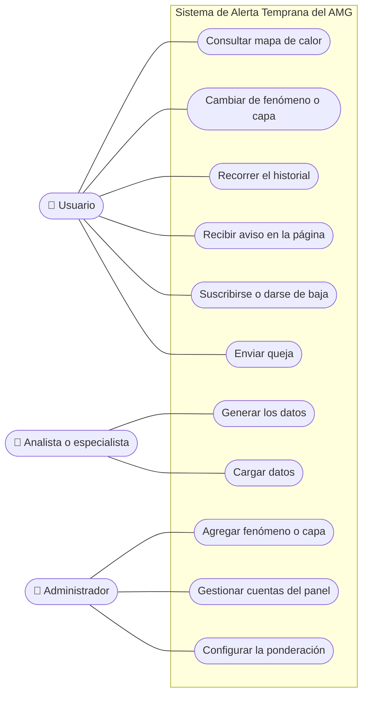
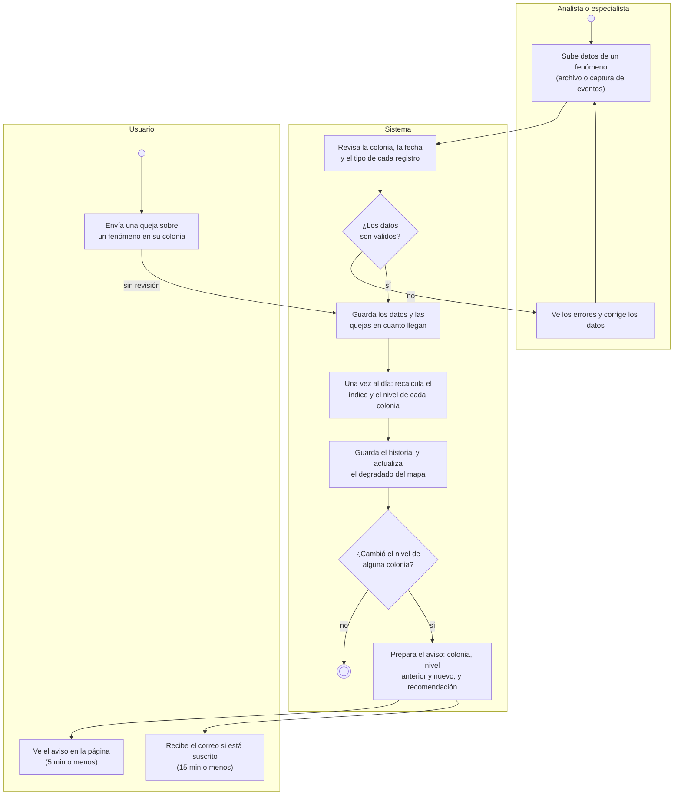

# Software Requirements Specification

### Sistema de Alerta Temprana del Área Metropolitana de Guadalajara
### (Phenomena Atlas)

**Integrantes**

Carolina Chi Arceo 
Dulce María Navarro Medina 
José Alejandro Labourdette-Lartigue Soto 
Edgar Hiram Torres del Toro

6 de noviembre de 2026

---

## Tabla de Contenidos

- [1. Introducción](#1-introducción)
   - [1.1. Propósito](#11-propósito)
   - [1.2. Alcance](#12-alcance)
   - [1.3. Glosario](#13-glosario)
   - [1.4. Referencias](#14-referencias)
- [2. Descripción general del sistema](#2-descripción-general-del-sistema)
   - [2.1. Perspectiva del producto](#21-perspectiva-del-producto)
   - [2.2. Funciones del producto](#22-funciones-del-producto)
   - [2.3. Características del usuario](#23-características-del-usuario)
   - [2.4. Restricciones](#24-restricciones)
   - [2.5. Supuestos y dependencias](#25-supuestos-y-dependencias)
- [3. Requisitos funcionales y del sistema](#3-requisitos-funcionales-y-del-sistema)
   - [3.1. Requisitos funcionales](#31-requisitos-funcionales)
   - [3.2. Requisitos no funcionales](#32-requisitos-no-funcionales)
   - [3.3. Requisitos de la interfaz externa](#33-requisitos-de-la-interfaz-externa)

---

## 1. Introducción

### 1.1. Propósito

Este SRS especifica qué debe hacer el Sistema de Alerta Temprana del AMG (Phenomena Atlas) y bajo qué condiciones. Reúne en un solo lugar lo que el equipo acordó con el cliente, el CINVESTAV Unidad Guadalajara: los fenómenos que se miden, cómo se representan en el mapa, cómo se avisa al usuario cuando algo cambia y qué datos alimentan cada cálculo.

Lo usará el cliente para validar que sus peticiones quedaron recogidas y el equipo como guía para diseñar, programar y probar.

### 1.2. Alcance

La plataforma es un sitio web cuyo centro es un mapa de calor de Guadalajara, Zapopan, San Pedro Tlaquepaque y Tonalá, dividido por colonias. Cada colonia se pinta según qué tan alto o bajo es su riesgo en el fenómeno elegido, y quien entra puede ver ese nivel, revisar cómo evolucionó y enterarse cuando cambia.

La primera entrega, el 11 de diciembre de 2026, incluye dos fenómenos: violencia de género y agua. El fenómeno Agua tiene dos capas: Calidad del agua, que muestra el agua sucia o contaminada que llega a los hogares, y Disponibilidad de agua, que muestra si las colonias tienen servicio. El usuario cambia entre ambas con el control de hojas apiladas del mapa.

Para esa entrega el sistema funcionará con datos sintéticos: cifras que genera el equipo, con comportamiento verosímil, pero que no corresponden a hechos ni a personas reales. Las únicas entradas que no provienen del generador son las quejas de los usuarios y los eventos que el analista o especialista capture manualmente. Así se puede probar todo el flujo (cálculo, colores, barra temporal y avisos) sin riesgo de exponer a una víctima ni de usar información protegida por la ley.

Dentro del alcance:

- Mapa de calor por colonia, para cada fenómeno o capa, con un degradado continuo de verde a amarillo y de amarillo a rojo.
- Índice de fenómenos ampliable, al que se agregan fenómenos nuevos sin rediseñar el sistema.
- Barra deslizante bajo el mapa para recorrer el historial de cada colonia.
- Notificaciones dentro de la página cuando el nivel de una colonia sube o baja.
- Notificaciones por correo electrónico, fuera de la página, para quien se suscriba.
- API que calcula los niveles y alimenta la web y futuros clientes.
- Recomendaciones de qué hacer y a dónde reportar, según el fenómeno y el nivel de cada colonia.
- Buzón de quejas para que los usuarios reporten de forma anónima un problema sobre un fenómeno en su colonia.

Fuera del alcance:

- Obtención automática de datos desde redes sociales (scraping).
- Atender directamente emergencias o enviar ayuda. El sistema orienta a la persona y la canaliza a la instancia correspondiente, pero la atención es función del 911 y de las autoridades.
- Garantía de que una colonia en verde es segura; el mapa refleja solo los eventos y quejas registrados.
- Predicción de quién será víctima o agresor, ni información de casos individuales.
- Certificación de la potabilidad del agua; corresponde a las autoridades del agua.
- Actualización en tiempo real: el índice se recalcula una vez al día.
- Apps para Android e iOS (fase futura).
- Envío de avisos del sistema por WhatsApp, SMS u otros medios. Fuera de la página, el sistema solo avisa por correo electrónico.

Se benefician los habitantes de los cuatro municipios, que pueden informarse sobre su colonia, y también los gobiernos locales y estatales y las organizaciones civiles que necesiten cifras agregadas para planear acciones de prevención.

### 1.3. Glosario

| **Término**               | **Definición**                                                                                                                                                                                                                                                                 |
|:--------------------------|:-------------------------------------------------------------------------------------------------------------------------------------------------------------------------------------------------------------------------------------------------------------------------------|
| SRS                       | Software Requirements Specification: especificación de requisitos de software, como la presente.                                                                                                                                                                               |
| Usuario                   | Persona que usa la aplicación web sin iniciar sesión: consulta el mapa, envía quejas, puede suscribirse con su correo para recibir avisos y darse de baja cuando quiera.                                                                                                       |
| Analista o especialista   | Persona con cuenta en el panel que registra eventos sobre los fenómenos y genera y carga los datos.                                                                                                                                                                            |
| Administrador             | Persona con cuenta en el panel que gestiona las cuentas del panel y los fenómenos, y define la gravedad, los pesos y los umbrales del cálculo.                                                                                                                                 |
| Stakeholder               | Persona u organización con interés en el resultado del proyecto, como el cliente o las autoridades, sin formar parte del equipo.                                                                                                                                               |
| Equipo de desarrollo      | Los cuatro integrantes que diseñan, programan, prueban y documentan el sistema.                                                                                                                                                                                                |
| Fenómeno                  | Tema de riesgo que el sistema mide y muestra, como violencia de género o agua.                                                                                                                                                                                                 |
| Capa                      | Vista de datos dentro de un fenómeno; por ejemplo, Calidad del agua y Disponibilidad de agua dentro del fenómeno Agua.                                                                                                                                                         |
| Control de hojas apiladas | Botón del mapa con icono de hojas superpuestas que despliega las capas del fenómeno activo.                                                                                                                                                                                    |
| Índice de fenómenos       | Menú donde el usuario elige qué fenómeno ver.                                                                                                                                                                                                                                  |
| Mapa de calor             | Mapa que colorea cada colonia con un degradado de verde a amarillo y de amarillo a rojo según su índice: cuanto más rojo, peor es su situación.                                                                                                                                |
| Nivel de riesgo           | Clasificación de una colonia en bajo, medio o alto según en qué tramo del degradado cae su índice. Se usa para los avisos y la tarjeta de la colonia. En la capa Disponibilidad de agua no hay degradado: tres colores fijos indican el estado del servicio (FR8).             |
| Índice                    | Valor que se calcula una vez al día por colonia y fenómeno o capa, y que determina su nivel de riesgo.                                                                                                                                                                         |
| Evento                    | Registro de un hecho relacionado con un fenómeno en una colonia, con fecha y tipo. Lo genera el generador de datos sintéticos o lo captura el analista o especialista.                                                                                                         |
| Panel                     | Sección de acceso restringido de la aplicación web, con inicio de sesión, donde trabajan el analista o especialista y el administrador.                                                                                                                                        |
| Datos sintéticos          | Datos generados por el equipo que imitan patrones plausibles sin describir hechos ni personas reales; se usan en la primera entrega.                                                                                                                                           |
| Colonia                   | Unidad geográfica en que se divide el mapa; cada colonia tiene su propio color.                                                                                                                                                                                                |
| Queja                     | Reporte anónimo que un usuario registra sobre un fenómeno en una colonia.                                                                                                                                                                                                      |
| Barra temporal            | Control deslizante bajo el mapa para elegir el día que se muestra.                                                                                                                                                                                                             |
| WCAG                      | Web Content Accessibility Guidelines (Pautas de Accesibilidad para el Contenido Web): estándar del W3C que indica cómo hacer un sitio web usable para personas con discapacidad, por ejemplo con baja visión o daltonismo. El nivel AA es el intermedio de tres (A, AA y AAA). |
| W3C                       | World Wide Web Consortium: organismo internacional que define los estándares de la web.                                                                                                                                                                                        |
| AMG / ZMG                 | Área (o Zona) Metropolitana de Guadalajara; ambos nombres se refieren al mismo territorio.                                                                                                                                                                                     |
| NFR                       | Requisito no funcional: describe cómo debe comportarse el sistema (rapidez, seguridad, facilidad de uso).                                                                                                                                                                      |
| FR                        | Requisito funcional: describe algo concreto que el sistema debe hacer.                                                                                                                                                                                                         |
| API                       | Punto de acceso por el que la página web y otros programas solicitan datos al sistema.                                                                                                                                                                                         |

### 1.4. Referencias

Basher, R. (2006). Global early warning systems for natural hazards: systematic and people-centred. *Philosophical Transactions of the Royal Society A, 364*(1845), 2167–2182. https://doi.org/10.1098/rsta.2006.1819

IEEE. (1998). *830-1998 - IEEE Recommended Practice for Software Requirements Specifications*. IEEE.

Sommerville, I. (2011). *Software Engineering* (9.ª ed.). Boston, Massachusetts: Pearson.

United Nations Office for Disaster Risk Reduction. (2017). *Early warning system*. Sendai Framework Terminology on Disaster Risk Reduction. Obtenido de: <https://www.undrr.org/terminology/early-warning-system>

World Meteorological Organization. (2018). *Multi-hazard Early Warning Systems: A Checklist*. Ginebra: WMO.

World Wide Web Consortium. (2018). *Web Content Accessibility Guidelines (WCAG) 2.1*. W3C Recommendation. Obtenido de: <https://www.w3.org/TR/WCAG21/>

## 2. Descripción general del sistema

### 2.1. Perspectiva del producto

La plataforma es independiente: no forma parte de otro sistema. En la entrega del 11 de diciembre se alimenta de los datos sintéticos que produce el propio equipo, de las quejas de los usuarios y de los eventos que el analista o especialista capture manualmente. Su función es traducir esas cifras en un color por colonia que cualquier persona entienda de un vistazo.

Quien visita el sitio decide qué fenómeno y qué capa mirar, mueve la barra temporal para comparar días y, si lo desea, deja su correo para enterarse de los cambios aunque no tenga la página abierta.

Los componentes principales son:

- Frontend (Cliente Web):

Permitirá visualizar el mapa de calor de cada fenómeno, cambiar de capa con las hojas apiladas cuando el fenómeno tenga más de una, recorrer el historial con la barra temporal, consultar los avisos, enviar quejas y suscribirse por correo. También incluirá el panel, la sección con inicio de sesión para el analista o especialista y el administrador. Toda la información la obtendrá de la API. Se desarrolla con React y TypeScript, y el mapa se dibuja con MapLibre GL JS.

- Backend (API del sistema):

Se divide en cuatro partes:

- Motor de cálculo: una vez al día recalcula el índice, el color y el nivel de cada colonia con los datos cargados y detecta si el nivel subió o bajó.
- Registro de fenómenos: catálogo donde cada fenómeno declara nombre, capas y método de cálculo.
- Servicio de notificaciones: publica los cambios de nivel en la web, y envía correos a los suscriptores.
- Servicios del panel: inicio de sesión por rol, carga de datos, captura de eventos, alta de fenómenos, configuración de la ponderación y gestión de cuentas del panel.

La API se desarrolla con NestJS. Una parte quedará abierta al público, pero solo con totales por colonia.

- Base de Datos

Contiene los eventos, las quejas, los niveles calculados por colonia y día, el catálogo de fenómenos y los correos suscritos. Se usa PostgreSQL con la extensión PostGIS, que permite guardar y consultar los polígonos de cada colonia.

La API y la aplicación web son dos proyectos independientes que se comunican mediante un contrato de endpoints. El contrato se escribe primero en TypeSpec y de él se genera automáticamente la definición OpenAPI que comparten ambos proyectos.

### 2.2. Funciones del producto
- Mapa de calor por colonia. Colorea cada colonia con un degradado de verde a amarillo y de amarillo a rojo según su índice en el fenómeno elegido.
- Índice de fenómenos y capas. El usuario elige el fenómeno en el índice y la capa con el control de hojas apiladas; el fenómeno Agua tiene las capas Calidad del agua y Disponibilidad de agua.
- Barra temporal. Al deslizarla, el color de cada colonia cambia si su índice cambió o se queda igual si no cambió.
- Notificaciones. Avisos dentro de la página y por correo cuando el nivel de una colonia sube o baja.
- Fenómenos ampliables. Se agregan fenómenos y capas nuevos, como inundaciones, sin cambiar el código del cliente web.
- Recomendaciones. Al seleccionar una colonia se muestra qué hacer y a dónde reportar, según el fenómeno y el nivel.
- Buzón de quejas. Los usuarios reportan de forma anónima un problema sobre un fenómeno en su colonia.

### 2.3. Características del usuario

Usuarios: consultan el mapa, recorren el historial, reciben avisos en la página, envían quejas, y pueden suscribirse o darse de baja de los avisos por correo.

Analista o especialista: desde el panel, registra eventos sobre los fenómenos y genera y carga los datos.

Administrador: gestiona cuentas del panel, fenómenos y capas, y define cómo se calcula el riesgo: la gravedad de cada tipo de evento, los pesos por antigüedad, los umbrales de los niveles y las demás funciones de ponderación.

### 2.4. Restricciones
- Los datos registrados en el sistema (eventos, quejas y niveles calculados) no podrán alterarse fuera de los procesos de carga y recálculo, ni compartirse con terceros, salvo las cifras por colonia de la API pública.
- El sistema se construirá solo con tecnologías web que funcionen en navegadores actuales (Google Chrome, Microsoft Edge, Mozilla Firefox y Safari).
- Para consultar el mapa y recibir información actualizada, la aplicación necesitará estar conectada a Internet en todo momento.
- El funcionamiento dependerá de servicios de terceros, como el mapa base, el hosting y el envío de correos, por lo que su disponibilidad quedará sujeta a las condiciones de cada proveedor.
- El desarrollo se hará con software y bibliotecas de código abierto, con excepción de los servicios externos mencionados.

### 2.5. Supuestos y dependencias

Se necesita conexión a Internet para usar la plataforma y comunicarse con los servicios externos.

La API y la aplicación web deberán mantenerse en funcionamiento y usar la misma versión del contrato de endpoints.

Los servicios externos (mapa base, hosting y envío de correos) deberán estar disponibles.

## 3. Requisitos funcionales y del sistema

### 3.1. Requisitos funcionales

#### FR1: Mostrar el mapa de los cuatro municipios
- Descripción: Mostrar un mapa interactivo de Guadalajara, Zapopan, San Pedro Tlaquepaque y Tonalá con los límites de cada colonia.
- Detalles:
  - El usuario puede desplazarse y hacer zoom; al abrir, el mapa encuadra los cuatro municipios.
  - El mapa se divide por colonias y cada colonia tiene su propio color.
- Precondición: El servicio de mapa base está disponible.
- Postcondición: El mapa queda listo para colorearse con el fenómeno activo.

#### FR2: Mapa de calor con degradado
- Descripción: Colorear cada colonia según su índice en el fenómeno o capa y el día seleccionados.
- Detalles:
  - El color es un degradado continuo de verde a amarillo y de amarillo a rojo: cuanto mayor es el índice, más rojo se ve la colonia.
  - Los umbrales que define el administrador (FR17) dividen el degradado en tres niveles, bajo, medio y alto, que se usan en la tarjeta de la colonia y en los avisos.
  - La capa Disponibilidad de agua no usa degradado: muestra tres colores fijos según el estado del servicio (FR8).
  - No hay color gris: las colonias sin eventos ni quejas se pintan según su índice calculado. Junto al mapa se aclara que el color refleja los eventos y quejas registrados y no necesariamente la situación real.
  - Una leyenda visible muestra la barra del degradado con los tres niveles marcados y la fecha del último cálculo.
  - Mientras se usen datos sintéticos, el mapa muestra un aviso fijo: «Datos de prueba: no representan hechos reales».
  - El degradado y sus tres colores de referencia (verde, amarillo y rojo) son siempre los mismos para todos los fenómenos y capas, y no se pueden cambiar.
- Precondición: El motor de cálculo tiene índices para el día seleccionado.
- Postcondición: Cada colonia muestra un color y la leyenda corresponde al fenómeno o capa activa.

#### FR3: Elegir fenómeno desde el índice
- Descripción: El usuario elige qué fenómeno ver desde el índice de fenómenos.
- Detalles:
  - Se muestra un fenómeno a la vez.
  - En la primera entrega el índice lista Violencia de género y Agua; las capas del agua se eligen con las hojas apiladas (FR4).
  - Los fenómenos nuevos aparecen al darse de alta (FR5).
- Postcondición: El mapa, la leyenda, la barra temporal y las capas disponibles cambian al fenómeno elegido.

#### FR4: Cambiar de capa con el control de hojas apiladas
- Descripción: El mapa tiene un botón con icono de hojas apiladas que despliega las capas del fenómeno activo.
- Detalles:
  - En el fenómeno Agua, las capas son Calidad del agua (predeterminada) y Disponibilidad de agua.
  - Se ve una capa a la vez y su nombre queda visible.
  - Si un fenómeno tiene una sola capa, el botón se oculta o se deshabilita.
- Postcondición: El mapa, la leyenda y la barra temporal muestran la capa elegida.

#### FR5: Agregar fenómenos y capas nuevos
- Descripción: Dar de alta un fenómeno nuevo, como inundaciones, o una capa nueva dentro de un fenómeno existente, y modificar las características de los fenómenos ya registrados, sin modificar el cliente web.
- Detalles:
  - Cada fenómeno o capa se registra con nombre, icono, descripción y método de cálculo.
  - Todos los fenómenos usan las mismas colonias: las de Guadalajara, Zapopan, San Pedro Tlaquepaque y Tonalá. Al dar de alta un fenómeno no se eligen colonias.
  - También se registran, por cada nivel, la recomendación para la persona y los medios de reporte o contacto (FR10).
- Precondición: El usuario inició sesión en el panel como administrador y el método de cálculo que usará el fenómeno ya está implementado en la API.
- Postcondición: El fenómeno aparece en el índice (o la capa en el control de hojas apiladas) y admite notificaciones y suscripciones.

#### FR6: Fenómeno Violencia de género
- Descripción: Calcular el riesgo de violencia de género por colonia.
- Detalles:
  - Índice calculado a partir de los eventos (FR13) y de las quejas de los usuarios (FR18), ponderados por gravedad y antigüedad, por cada 10,000 mujeres de la colonia.
  - En la primera entrega, los eventos y la población de mujeres de cada colonia provienen del generador de datos sintéticos (FR16).
  - La gravedad de cada tipo de evento y los pesos por antigüedad los define el administrador (FR17).
  - El usuario puede filtrar el mapa para ver solo un tipo de violencia de género.
- Precondición: Hay eventos o quejas de violencia de género registrados.
- Postcondición: Queda un índice y un nivel por colonia y por día en el historial.

#### FR7: Fenómeno Agua: capa Calidad del agua
- Descripción: Mostrar el riesgo de agua contaminada (agua sucia) por colonia.
- Detalles:
  - Índice calculado a partir de los eventos (FR13) y de las quejas de los usuarios (FR18), ponderados por antigüedad; se colorea con el mismo degradado que los demás fenómenos.
  - En la primera entrega, los eventos provienen del generador de datos sintéticos (FR16).
- Precondición: Hay quejas o eventos registrados sobre la calidad del agua.
- Postcondición: Queda un índice y un nivel por colonia y por día en el historial.

#### FR8: Fenómeno Agua: capa Disponibilidad de agua
- Descripción: Dentro del fenómeno Agua, mostrar si cada colonia tiene servicio de agua.
- Detalles:
  - Sin degradado: el color indica el estado del servicio, no un índice de riesgo: verde con servicio; amarillo servicio intermitente, tandeo o corte programado; rojo sin servicio.
  - El estado de cada colonia se determina una vez al día con los eventos (FR13) y las quejas de los usuarios (FR18) sobre la disponibilidad de agua. El administrador define cuántos eventos o quejas llevan a cada estado (FR17).
  - En la primera entrega, los eventos provienen del generador de datos sintéticos (FR16).
- Postcondición: Queda el estado de cada colonia por día en el historial.

#### FR9: Barra temporal bajo el mapa
- Descripción: Una barra deslizante bajo el mapa permite recorrer el historial del fenómeno o capa activa.
- Detalles:
  - Cada paso de la barra es un día, que es la frecuencia con que se recalcula el índice.
  - Al deslizar, el mapa se recolorea con el índice de ese día; las colonias cuyo índice no cambió conservan su color.
  - Junto a la barra se muestra el día seleccionado y cuántas colonias subieron, bajaron o se mantuvieron frente al día anterior.
  - Por defecto, la barra se ubica en el día más reciente.
- Postcondición: El detalle de colonia (FR10) refleja el día elegido.

#### FR10: Detalle de colonia
- Descripción: Al seleccionar una colonia, mostrar una tarjeta con su situación y qué hacer al respecto.
- Detalles:
  - Nombre o identificador de la colonia y si su nivel subió, bajó o se mantuvo frente al día anterior.
  - Nivel actual (bajo, medio o alto), índice y fecha del cálculo. En la capa Disponibilidad de agua se muestra el estado del servicio en lugar del nivel y el índice.
  - Recomendación de acción según el fenómeno y el nivel, con los medios para reportar o pedir ayuda. Ejemplo para la capa Calidad del agua: «No consumas el agua de esta zona. Repórtala a SIAPATEL 073 o al WhatsApp 33 5164 4440». Ejemplo para Violencia de género: «Si necesitas ayuda, llama al 911».
  - Las recomendaciones y los contactos se configuran por fenómeno y nivel (FR5), sin cambiar el código.
- Postcondición: La persona sabe el nivel de la colonia, cómo ha cambiado y a quién acudir.

#### FR11: Notificaciones dentro de la página
- Descripción: Mientras la página está abierta, avisar cuando el nivel de una colonia sube o baja.
- Detalles:
  - Se notifica cuando una colonia cambia de nivel tras el recálculo diario. Ejemplo: «Calidad del agua en la colonia 07-C subió de nivel medio a alto». El aviso incluye la recomendación de la colonia (FR10).
  - La página consulta novedades al menos cada 5 minutos; un centro de notificaciones guarda los avisos de la sesión.
- Postcondición: Al pulsar un aviso, el mapa abre el fenómeno, la capa y la colonia del cambio.

#### FR12: Notificaciones por correo
- Descripción: Enviar correos a los suscriptores cuando sube o baja el nivel de las colonias y fenómenos que eligieron.
- Detalles:
  - El usuario se suscribe con su correo, elige colonias y fenómenos y acepta el aviso de privacidad.
  - La suscripción se activa solo tras confirmar desde un enlace enviado al correo.
  - Cada correo indica fenómeno, colonia, nivel anterior y nuevo, fecha, la recomendación con sus contactos (FR10) y enlace al mapa, e incluye un enlace para darse de baja en un clic.
  - Mientras se usen datos sintéticos, cada correo aclara que se trata de datos de prueba.
  - Si varias colonias cambian en el mismo recálculo, se envía un solo correo con todos los cambios.
- Precondición: El servicio de correo está configurado.
- Postcondición: El envío queda registrado sin guardar el contenido del correo.

#### FR13: Carga de datos
- Descripción: El analista o especialista carga datos nuevos (archivo o captura manual de eventos). Los datos se guardan en cuanto se suben, sin pasar por aprobación.
- Detalles:
  - Acepta el conjunto de datos sintéticos que produce el generador (FR16) y los eventos que el analista o especialista captura manualmente.
  - El sistema rechaza registros con colonia, fecha o tipo inválidos.
  - Los datos cargados entran en el siguiente recálculo diario, que es el que dispara FR11 y FR12.
- Precondición: El usuario tiene rol de analista o especialista.
- Postcondición: El historial guarda quién cargó los datos y cuándo.

#### FR14: Gestión de roles y cuentas del panel
- Descripción: El administrador crea, desactiva y asigna rol a las cuentas del panel (analistas o especialistas y administradores).
- Detalles:
  - Cada acción del panel se permite según las funciones de cada rol descritas en la sección 2.3.
  - Cada cambio de rol queda registrado.
- Precondición: Existe al menos un administrador.
- Postcondición: Cada cuenta solo ve en el panel las acciones de su rol.

#### FR15: API pública de datos agregados
- Descripción: La API ofrece endpoints públicos con niveles e índices por colonia y día, solo con cifras agregadas.

#### FR16: Generación de datos sintéticos
- Descripción: Un generador produce los datos de prueba de los dos fenómenos, incluidas las dos capas del agua, para la primera entrega.
- Detalles:
  - Crea registros por colonia y día con un formato fijo para cada fenómeno.
  - Incluye a propósito días en que las colonias suben, bajan o se mantienen, para poder probar colores, barra temporal y notificaciones.
  - Los rangos y tendencias se configuran por fenómeno.
  - Usa una semilla fija, de modo que el mismo conjunto se pueda volver a generar para las pruebas.
  - No toma como base ningún registro individual real.
- Precondición: El usuario tiene rol de analista o especialista.
- Postcondición: El conjunto queda cargado y marcado como sintético en la base de datos.

#### FR17: Configuración de la ponderación
- Descripción: El administrador modifica desde el panel cómo se calcula el riesgo de cada fenómeno.
- Detalles:
  - Puede cambiar la gravedad de cada tipo de evento, los pesos por antigüedad, los umbrales que separan los niveles bajo, medio y alto en el degradado, y las demás funciones de ponderación.
  - Un cambio guardado se aplica en el siguiente recálculo diario, y se conserva la versión anterior del método (NFR12).
  - Cada cambio registra quién lo hizo y cuándo.
- Precondición: El usuario tiene rol de administrador.
- Postcondición: Los niveles del mapa reflejan la nueva ponderación.

#### FR18: Buzón de quejas
- Descripción: El usuario registra una queja sobre un fenómeno en una colonia; por ejemplo, agua sucia en su casa.
- Detalles:
  - El usuario elige el fenómeno (y la capa, si aplica), la colonia y describe el problema.
  - La queja es anónima: no se piden nombre, teléfono ni dirección. Antes de enviarla se muestra el aviso de privacidad.
  - La queja se registra de inmediato, sin pasar por aprobación, y se suma al índice de ese fenómeno en esa colonia en el siguiente recálculo diario. Con el tiempo pierde peso.
  - Al enviar, se muestran los medios de reporte o ayuda del fenómeno (FR10), como SIAPATEL 073 para el agua o el 911 para violencia de género.
- Precondición: No se requiere iniciar sesión.
- Postcondición: La queja queda guardada sin datos personales y cuenta en el siguiente recálculo diario.

### 3.2. Requisitos no funcionales

NFR1: Cualquier persona debe entender el mapa sin leer un manual. La leyenda y la fecha del último cálculo estarán siempre visibles; 4 de 5 usuarios de prueba deben identificar la colonia de mayor riesgo en menos de 30 segundos.

NFR2: Pasar de un fenómeno, capa o día a otro no debe tomar más de 2 clics o toques.

NFR3: El color no debe ser la única señal: cada colonia mostrará también su nivel con texto o patrón, y el contraste cumplirá el nivel AA de las Pautas de Accesibilidad para el Contenido Web, WCAG 2.1 (World Wide Web Consortium [W3C], 2018).

NFR4: La web debe funcionar en celular, tableta y computadora, desde 360 px de ancho, en navegadores actuales.

NFR5: El mapa debe mostrarse en menos de 3 segundos con conexión 4G, y la barra temporal debe recolorear el mapa en menos de 500 ms por paso.

NFR6: Los avisos deben llegar en 5 minutos o menos en la página y en 15 minutos o menos por correo, tras el recálculo.

NFR7: Un fenómeno nuevo debe poder darse de alta sin cambios en el código del cliente web.

NFR8: Ningún registro de la base de datos debe permitir identificar a una víctima o persona afectada: los eventos y las quejas se guardan sin nombres, teléfonos ni direcciones, y el mapa solo muestra cifras por colonia.

NFR9: De quien se suscribe solo se guardan su correo y sus preferencias, cifrados, y se borran al darse de baja.

NFR10: Solo el analista o especialista y el administrador pueden modificar datos y fenómenos, cada uno según su rol, mediante un panel con inicio de sesión y permisos por rol; todo el tráfico usa HTTPS.

NFR11: Toda cifra mostrada debe indicar de qué tipo de datos proviene (datos sintéticos, eventos capturados o quejas de los usuarios) y la fecha del cálculo.

NFR12: Los cálculos deben poder reproducirse: cada nivel guarda la versión del método y de los pesos con que se calculó.

NFR13: Disponibilidad del 99 % mensual; si falla el recálculo diario, se muestra el último nivel calculado con su fecha.

NFR14: Otra persona del equipo debe poder instalar y modificar el sistema siguiendo la documentación: contrato de la API escrito en TypeSpec, con su definición OpenAPI generada automáticamente, y repositorios con guía de instalación.

NFR15: Cada registro guarda su origen (generador de datos sintéticos, captura del analista o especialista, o queja de usuario), y los datos sintéticos siempre se identifican como datos de prueba.

### 3.3. Requisitos de la interfaz externa

Estas son las conexiones de la plataforma con componentes y servicios externos a la aplicación, y su situación actual:

- MapLibre GL JS y un proveedor de mapa base para dibujar el mapa y los límites de colonias (en evaluación).
- Fuente de los límites geográficos de las colonias de la ZMG (por confirmar).
- Uso de un servicio de correo (SMTP o API) para confirmaciones y alertas (por elegir).
- Base de datos PostgreSQL con PostGIS.
- Hosting con plan gratuito o académico para la API, la aplicación web y la base de datos (por definir).

| **Actor**                     | **Descripción**                                                                                                                                      |
|:------------------------------|:-----------------------------------------------------------------------------------------------------------------------------------------------------|
| Usuario                       | Persona que consulta el mapa, cambia de fenómeno, capa y día, recibe avisos en la página, envía quejas, y puede suscribirse a los avisos por correo. |
| Analista o especialista       | Registra eventos y genera y carga los datos.                                                                                                         |
| Administrador                 | Gestiona fenómenos, capas y cuentas del panel, y configura la gravedad, los pesos y los umbrales del cálculo.                                        |
| Generador de datos sintéticos | Programa del equipo que produce los datos de prueba de la primera entrega.                                                                           |
| Servicio de correo            | Entrega los correos a los suscriptores.                                                                                                              |
| Base de Datos                 | Conserva los eventos, las quejas, los niveles por colonia y día, el catálogo de fenómenos y los correos suscritos.                                   |

| **Código** | **Caso de uso** | **Actor Principal** | **Descripción breve** |
|:---|:---|:---|:---|
| C1 | Consultar mapa de calor | Usuario | Ve el nivel de cada colonia en el fenómeno activo. |
| C2 | Cambiar de fenómeno | Usuario | Elige un fenómeno en el índice. |
| C3 | Cambiar de capa | Usuario | Usa las hojas apiladas para pasar de la capa Calidad del agua a Disponibilidad de agua. |
| C4 | Recorrer el historial | Usuario | Desliza la barra temporal y ve cómo cambian los colores. |
| C5 | Ver detalle de colonia | Usuario | Consulta nivel, índice, cambio, fecha y recomendación. |
| C6 | Recibir aviso en la página | Usuario | Ve que una colonia subió o bajó de nivel. |
| C7 | Suscribirse por correo | Usuario | Elige colonias y fenómenos y confirma su correo. |
| C8 | Darse de baja | Usuario | Cancela la suscripción desde el enlace del correo. |
| C9 | Cargar datos | Analista o especialista | Sube un archivo de datos o captura eventos; los datos quedan guardados sin aprobación. |
| C10 | Agregar fenómeno o capa | Administrador | Registra un fenómeno o capa nuevos. |
| C11 | Gestionar cuentas del panel | Administrador | Crea cuentas del panel y les asigna rol. |
| C12 | Recalcular niveles | Sistema | Una vez al día calcula los índices, detecta cambios y dispara avisos. |
| C13 | Generar los datos | Analista o especialista | Produce el conjunto de prueba de los dos fenómenos, incluidas las dos capas del agua, y lo envía a carga. |
| C14 | Configurar la ponderación | Administrador | Cambia la gravedad, los pesos y los umbrales del cálculo. |
| C15 | Enviar queja | Usuario | Registra de forma anónima un problema sobre un fenómeno en una colonia. |

*Casos de uso*

*Diagrama de actividades*

**Secuencia «Suscribirse por correo»**

Usuario → Interfaz Web: abrir «Recibir alertas», escribir su correo y elegir colonias y fenómenos

Interfaz Web → Usuario: mostrar el aviso de privacidad para su aceptación

Interfaz Web → API: enviar correo, colonias y fenómenos

API → Base de Datos: guardar la suscripción como pendiente

API → Servicio de correo: enviar el enlace de confirmación

Usuario → API: abrir el enlace; la suscripción queda activa

Usuario → API: «Darse de baja» desde cualquier correo; se borran su correo y preferencias

**Secuencia «Recorrer el historial»**

Usuario → Interfaz Web: elegir un fenómeno en el índice y, si aplica, una capa

Interfaz Web → API: solicitar los niveles por colonia de los días disponibles

API → Interfaz Web: devolver niveles, índices y fechas de cálculo

Usuario → Interfaz Web: deslizar la barra a un día

Interfaz Web → Usuario: recolorear las colonias que cambiaron, dejar igual las demás y mostrar cuántas subieron, bajaron o se mantuvieron

**Secuencia «Cargar datos y notificar»**

Analista o especialista → Panel: subir un archivo de datos de un fenómeno

Panel → API: enviar el archivo para validar colonia, fecha y tipo de cada registro

API → Base de Datos: guardar los datos cargados hasta el recálculo diario

Motor de cálculo (una vez al día) → Base de Datos: recalcular índices y niveles de todas las colonias

Motor de cálculo → Base de Datos: guardar niveles, historial y versión del método

Servicio de notificaciones → Interfaz Web: publicar los cambios de nivel

Servicio de notificaciones → Servicio de correo: enviar un correo por suscriptor afectado
