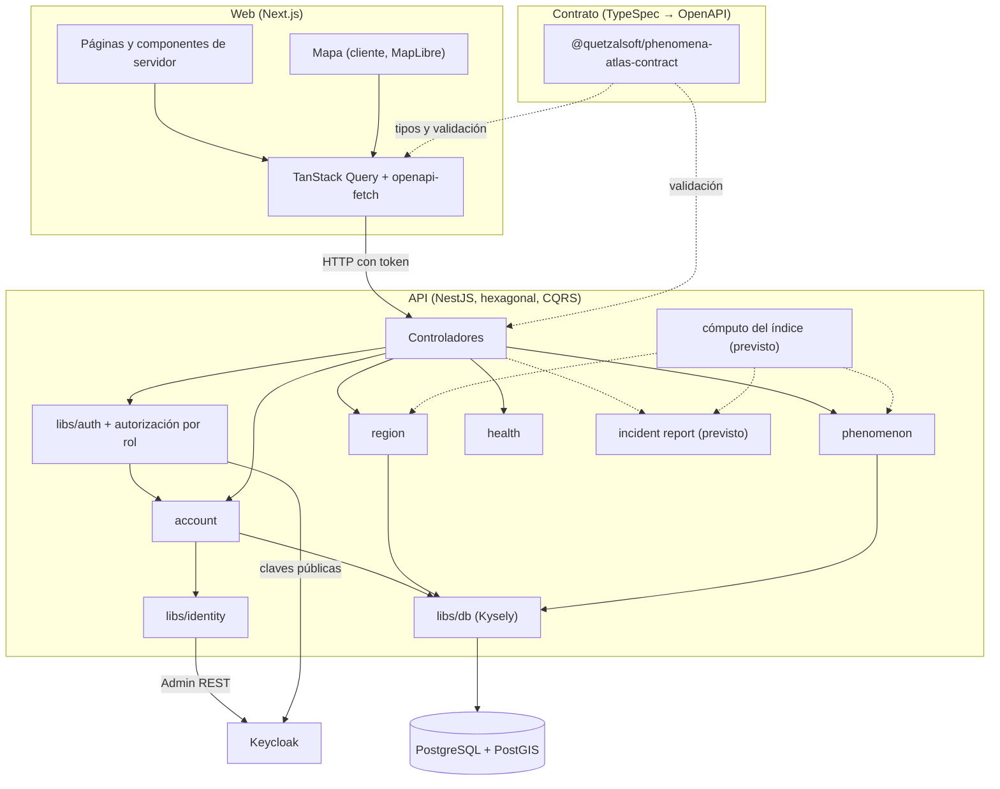
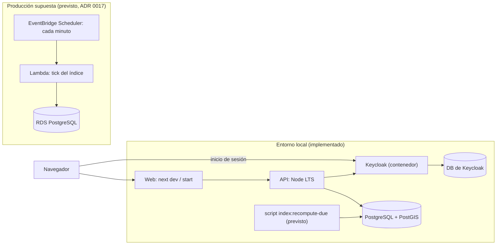
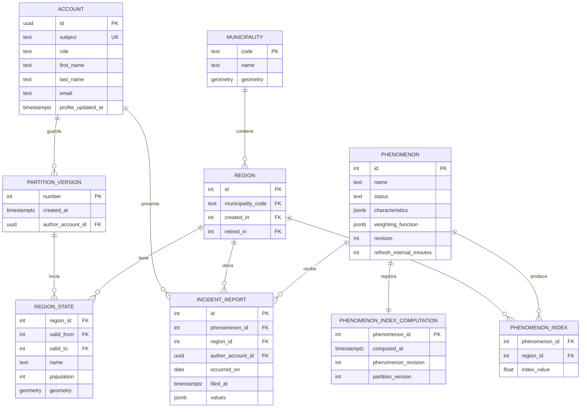
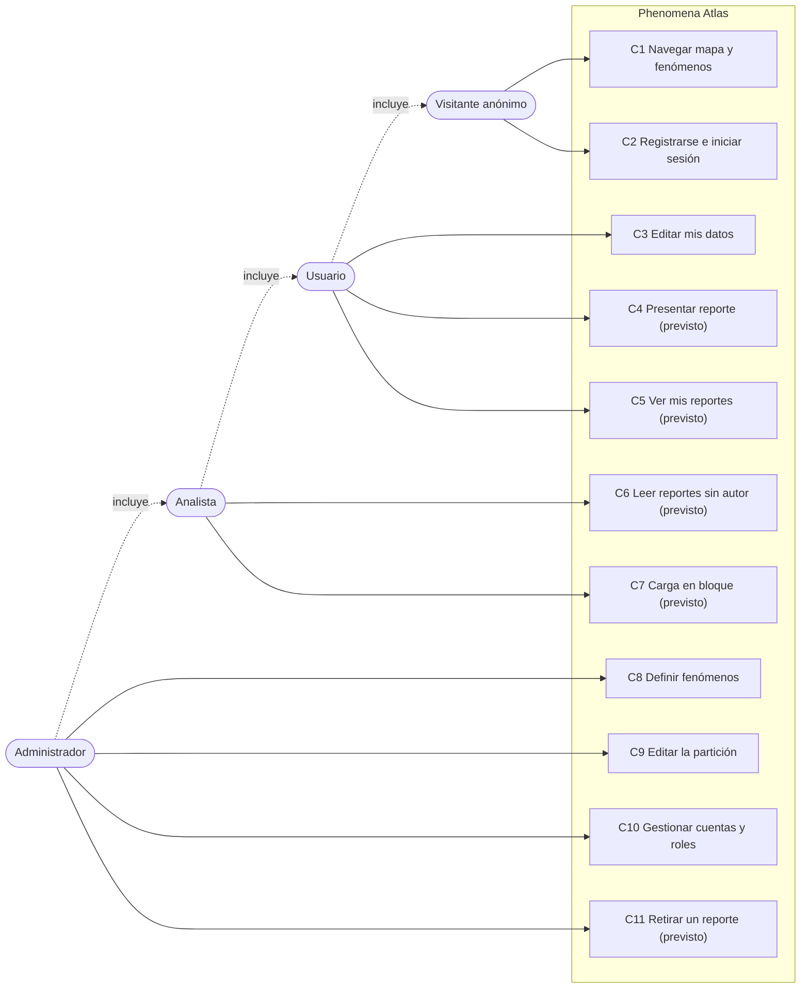
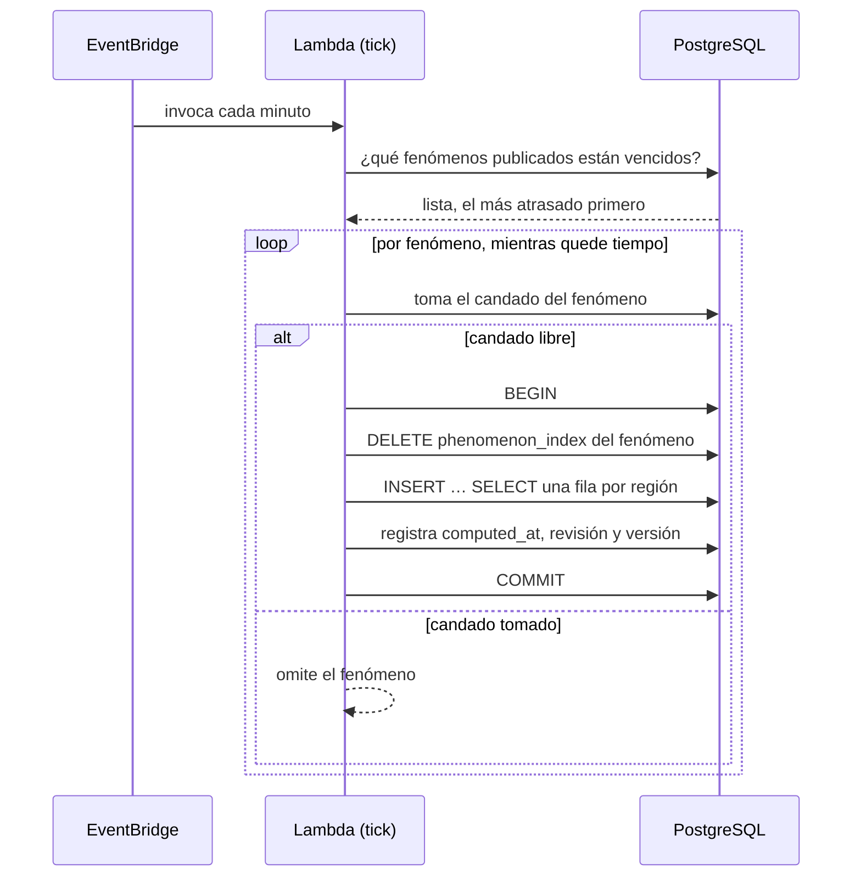
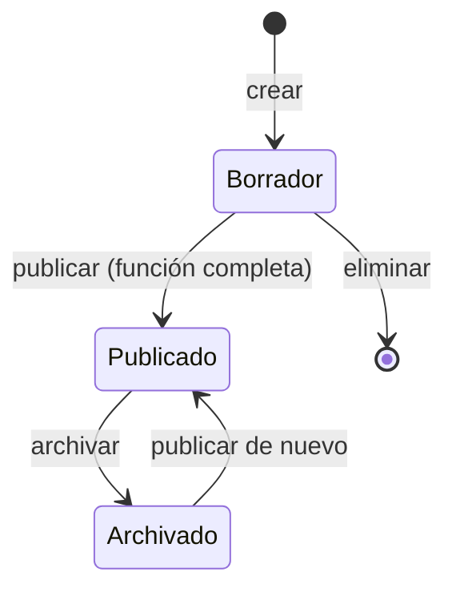
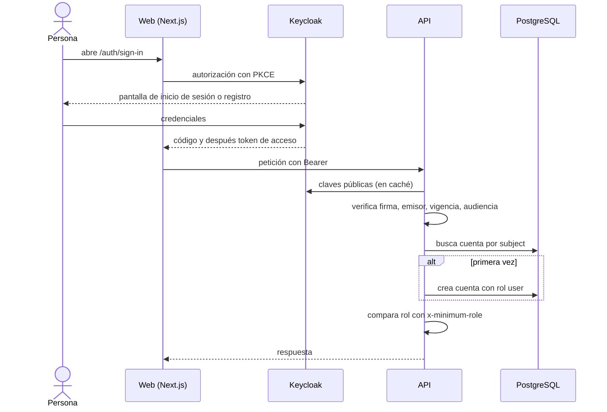
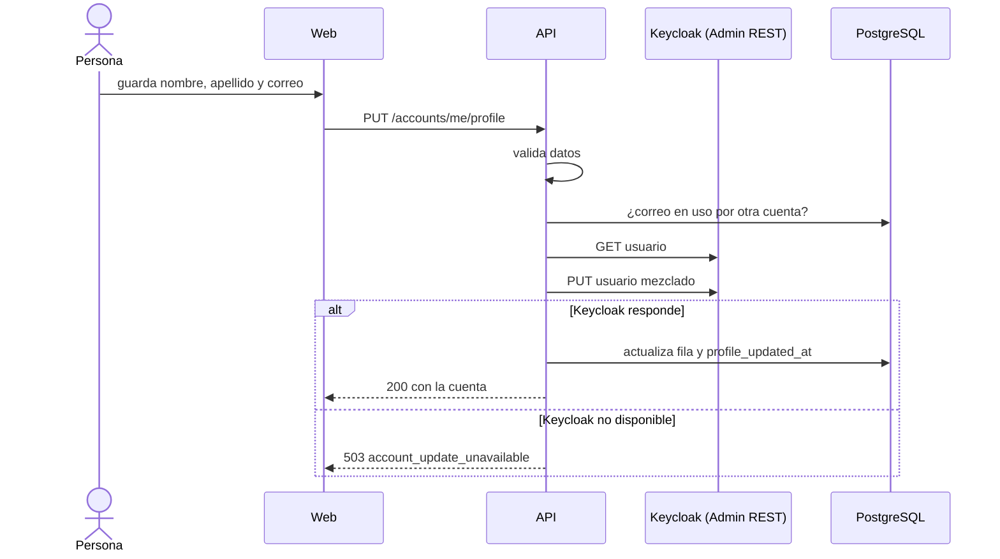
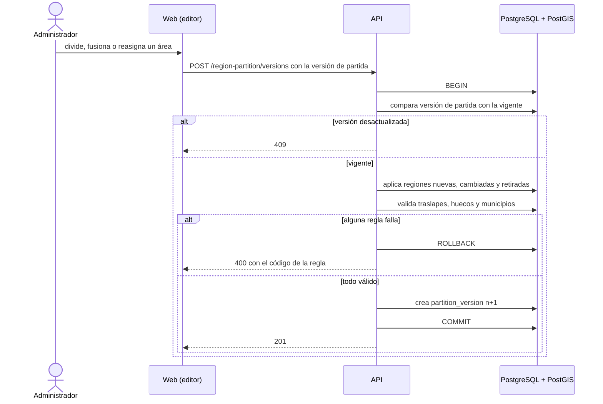

**DESCRIPCIÓN DE DISEÑO DEL SOFTWARE**

**Phenomena Atlas**

Sistema de Alerta Temprana del Área Metropolitana de Guadalajara

Conforme a IEEE Std 1016-1998

**Quetzal Soft**

Alejandro Labourdette

Carolina Chi

Dulce Navarro

Edgar Torres

Cliente: CINVESTAV Unidad Guadalajara (IPN)

Última actualización 28 de noviembre de 2026

**Revisiones**

| Fecha      | Nombre del archivo | Baseline                                        | Evaluadores |
|------------|--------------------|-------------------------------------------------|-------------|
| 11/11/2026 | SDD_v_1.md         | v1.0, línea base inicial                        | Por asignar |
| 28/11/2026 | SDD_v_2.md         | v2.0, alineada con lo implementado y los ADR 0001 a 0017 | Por asignar |

La versión 1.0 se conserva sin cambios en `SDD_v_1.md`. Esta versión
reemplaza como referencia vigente al diseño inicial, que partía del SRS
1.0 y se separó de él durante la implementación.

**Contenido**

1. Introducción
2. Referencias
3. Descripción de la decomposición
4. Descripción de dependencias
5. Descripción de interfaces
6. Diseño detallado
7. Trazabilidad con el SRS
8. Decisiones abiertas y riesgos de diseño
9. Anexo A. Modelo 4+1 y diagramas
10. Anexo B. Cambios respecto de la versión 1.0

## 1. Introducción

### 1.1 Propósito

Este documento describe el diseño de Phenomena Atlas: qué piezas lo
forman, cómo se relacionan y por qué se decidió así. Lo leen los cinco
integrantes del equipo, el cliente y quien evalúe el proyecto.

La versión 2.0 distingue tres estados para cada elemento del diseño:

- **Implementado**: existe en el código de `api/`, `web/` o `contracts/` y tiene pruebas.
- **Parcial**: existe una parte; el texto dice cuál.
- **Previsto**: está decidido en un ADR o en la versión 1.0, pero todavía no existe en el código.

El estado se refiere al repositorio al 28 de noviembre de 2026.

### 1.2 Alcance

Phenomena Atlas pinta, sobre un mapa del área metropolitana de
Guadalajara (Guadalajara, Zapopan, San Pedro Tlaquepaque y Tonalá), un
índice por región para cada fenómeno (por ejemplo, violencia de género o
calidad del agua). El índice sale de los reportes de incidentes que
presentan las personas con cuenta. Los administradores definen los
fenómenos, la partición en regiones y las cuentas. El diseño cubre:

- la API (NestJS, PostgreSQL con PostGIS);
- la aplicación web (Next.js y MapLibre GL JS);
- el contrato TypeSpec y OpenAPI que las une;
- la identidad (Keycloak) y el cómputo periódico del índice.

La aplicación móvil queda fuera de esta versión; el contrato está pensado
para que pueda existir (ADR 0001).

### 1.3 Acrónimos y definiciones

El vocabulario del dominio está en `docs/domain.md` y manda sobre este
documento. Términos usados aquí:

| Término | Significado |
|---|---|
| ADR | Registro de decisión de arquitectura (`docs/adr/`) |
| Fenómeno | Algo que el atlas mapea; se define con datos, no con código (ADR 0012) |
| Característica | Campo que lleva cada reporte de un fenómeno |
| Función de ponderación | Árbol de expresión que convierte los reportes de una región en su índice |
| Región | Área del mapa con id entero estable, nombre y población |
| Partición | Conjunto de regiones que cubre exactamente el área metropolitana |
| Versión de partición | Estado guardado e inmutable de la partición |
| Reporte de incidente | Declaración de una cuenta sobre un fenómeno en una región y una fecha |
| Índice | Valor que la función de ponderación da a cada región |
| OIDC, PKCE | OpenID Connect y su extensión de código de autorización con prueba de clave |
| CQRS | Separación de comandos y consultas |

## 2. Referencias

- SRS 1.0 (requisitos FR1 a FR18, NFR1 a NFR15 y RP1 a RP4) y SPMP 1.0.
- IEEE Std 1016-1998, *Recommended Practice for Software Design Descriptions*.
- `docs/adr/0001` a `0017` (decisiones) y `docs/architecture.md`.
- `docs/domain.md` (glosario), `docs/roles.md` (matriz de permisos) y `docs/release.md` (flujo de entrega).
- `contracts/main.tsp` y `contracts/generated/openapi.yaml` (contrato).
- Repositorios `api/` y `web/`, cada uno con su `docs/architecture.md`.
- Fuentes de datos de regiones: INEGI (Marco Geoestadístico y Censo 2020) e IMEPLAN (ADR 0010).
- Kruchten, P. (1995). *The 4+1 View Model of Architecture*.

## 3. Descripción de la descomposición

### 3.1 Visión general y estilos de arquitectura

| Estilo | Dónde se aplica | Referencia |
|---|---|---|
| Polirrepo con contrato | Raíz (documentos y contrato), `api/` y `web/` en repositorios aparte | ADR 0001 |
| Contrato primero | `main.tsp` se escribe antes del código y se publica como `@quetzalsoft/phenomena-atlas-contract` | ADR 0002 y 0003 |
| Arquitectura hexagonal con dominio al centro (domain-driven hexagon) | API: cortes verticales por caso de uso, capas hacia adentro | ADR 0006 |
| CQRS | Comandos y consultas separados dentro de cada módulo de la API | ADR 0006 |
| Cliente–servidor con servidor de presentación | Next.js (App Router) llama a la API como cualquier cliente; no tiene base de datos ni reglas de dominio | ADR 0007 |
| Identidad delegada | Keycloak autentica; la API solo verifica tokens y decide permisos | ADR 0008 y 0009 |
| Definición por datos | Fenómenos, características y función de ponderación son datos | ADR 0012 |
| Versionado inmutable | La partición de regiones solo crece por versiones nuevas | ADR 0011 |

Dos reglas atraviesan el diseño. La API es el único componente con acceso
a la base de datos. Una discrepancia entre el contrato y cualquier
implementación se corrige en la implementación.

### 3.2 Descomposición en módulos

#### 3.2.1 Subsistema de la API (Implementado, salvo lo indicado)

Cada módulo sigue la estructura `commands`, `queries`, `domain`,
`database` y su archivo de módulo de NestJS. Un módulo solo usa a otro
por eventos o por su fachada `*.public.ts`.

| Módulo / carpeta | Responsabilidad | Depende de | Estado |
|---|---|---|---|
| `libs/auth` | Verifica el token (firma, emisor, vigencia, audiencia `phenomena-atlas-api`) y arma la identidad de la petición | Claves públicas de Keycloak | Implementado |
| `libs/identity` | Cliente de la API de administración de Keycloak (cuenta de servicio) | Keycloak | Implementado |
| `libs/api` | Filtro de errores con la forma `Error` del contrato; validación con `express-openapi-validator` | Contrato | Implementado |
| `libs/db` | Conexión y tipos de Kysely | PostgreSQL | Implementado |
| `modules/account` | Cuentas, roles, guarda de autorización (`x-minimum-role`), edición de perfil | `libs/*` | Implementado |
| `modules/region` | Municipios, partición vigente, versiones, validación espacial con PostGIS, carga inicial | `libs/db` | Implementado |
| `modules/phenomenon` | Definición de fenómenos, características, función de ponderación, estados y revisión | `libs/db`, `region` (solo lectura, ADR 0016) | Implementado (definición); el cómputo del índice es Previsto |
| `modules/health` | Sonda de vida `GET /health` | Ninguna | Implementado |
| Reportes de incidentes | Alta, listado y retiro de reportes | `phenomenon`, `region`, `account` | Previsto (contrato listo; API pendiente, #46) |
| Cómputo del índice | Recálculo cuando vence el intervalo | `phenomenon`, `region`, reportes | Previsto (ADR 0015 a 0017, #24 y #44) |
| Carga masiva | Ingesta para analistas | Reportes | Previsto (#25) |
| Avisos y correo | Avisos en la página y correo a suscriptores | Índice | Previsto (versión 1.0, sección 6.4 anterior) |

Comandos de línea (sin arrancar NestJS completo): `migrate`, `set-role`
(para sembrar al primer administrador) y `load-regions` (carga inicial de
la partición, ADR 0010).

#### 3.2.2 Subsistema web (Next.js)

| Pieza | Responsabilidad | Estado |
|---|---|---|
| `app/` rutas | `/` y `/dashboard`; `/account`; `/admin/accounts`; `/admin/phenomena` y `/admin/phenomena/[id]`; `/admin/regions` y `/admin/regions/history`; `/auth/sign-in`, `/auth/sign-out`, `/auth/sign-up` y `/auth/error`; `/api/auth` (Auth.js) | Implementado |
| `features/map` | Mapa con MapLibre GL JS, siempre en el cliente | Implementado |
| `features/region` | Editor de la partición: dividir con una línea, fusionar vecinas y reasignar un área; historial de versiones | Implementado |
| `features/phenomenon` | Editor de características y editor visual de la función de ponderación; lista y estados | Implementado |
| `features/account` | Menú de cuenta, edición del perfil propio, tabla de cuentas con filtros, cambio de rol, definición de roles | Implementado |
| `features/system-status` | Tarjetas de salud del servidor y del navegador | Implementado |
| Pantalla pública del mapa por fenómeno con índice, leyenda y barra temporal | Previsto |
| Formulario de reporte de incidente | Previsto |
| Centro de notificaciones y suscripción por correo | Previsto |

El cliente llama a la API solo con `openapi-fetch` y los tipos generados
del contrato; el servidor de Next.js no expone acciones de servidor y
reutiliza el token del usuario (ADR 0007). Los datos del servidor se
cachean con TanStack Query. El estado del mapa vive en la URL.

#### 3.2.3 Subsistema de identidad

Keycloak 26 (contenedor propio y base de datos propia, ADR 0008) emite
tokens OIDC. El reino se importa de un archivo; solo se aplica al crear el
contenedor. Hay dos clientes: el de la web (código de autorización con
PKCE) y la cuenta de servicio de la API, que usa `client_credentials` para
editar datos de usuarios (ADR 0014). El registro de personas nuevas lo
hace Keycloak con su pantalla de autorregistro.

### 3.3 Despliegue

| Elemento | Local (Implementado) | Producción (Previsto) |
|---|---|---|
| API | Node.js LTS con `bun` como gestor de paquetes | Por definir; el ADR 0017 supone AWS |
| Web | `next dev` o `next start` | Por definir (necesita un servidor Node) |
| PostgreSQL con PostGIS | Contenedor en `compose.yaml` | RDS con autenticación IAM (supuesto del ADR 0017) |
| Keycloak y su base de datos | Contenedor | Contenedor con dominio propio `auth.<dominio>` |
| Cómputo periódico | Script `index:recompute-due` | EventBridge Scheduler cada minuto que invoca una Lambda (arm64, 512 MB, concurrencia reservada 1) |

El hosting sigue sin decidirse (sección 8). Las ramas son `main`
(producción) y `develop` (integración del sprint, ADR 0005). El contrato
se publica primero, luego la API y al final los clientes
(`docs/release.md`).

### 3.4 Modelo de datos

Tablas de la API (migraciones en `api/database/migrations`).

| Tabla | Contenido | Estado |
|---|---|---|
| `account` | `id` uuid, `subject` (único, id de Keycloak), `username`, `name`, `first_name`, `last_name`, `email`, `role`, `created_at`, `profile_updated_at` | Implementado |
| `municipality` | `code` de cinco dígitos (clave INEGI), `name`, `geometry` MultiPolygon 4326 | Implementado |
| `partition_version` | `number`, `created_at`, `author_account_id` | Implementado |
| `region` | `id` entero estable, `municipality_code`, `created_in`, `retired_in` | Implementado |
| `region_state` | Estado de una región entre `valid_from` y `valid_to`: `name`, `population`, `geometry` | Implementado |
| `phenomenon` | `id`, `name`, `description`, `status`, `characteristics` (jsonb), `weighting_function` (jsonb), `revision`, fechas | Implementado |
| `phenomenon.refresh_interval_minutes` | Intervalo de recálculo, 60 por omisión | Previsto en la API (el contrato ya lo declara, ADR 0015) |
| `phenomenon_index`, `phenomenon_index_computation` | Índice por fenómeno y región; una fila por cómputo (ADR 0016) | Previsto |
| `incident_report` | Reporte: fenómeno, región, fecha del incidente, fecha de alta, autor, descripción opcional, valores por característica | Previsto (ADR 0013) |

Decisiones de modelo que conviene tener a la vista:

- Los valores de los reportes se guardan por clave de característica, sin una columna por característica; la API valida los tipos (ADR 0012).
- Un reporte guarda una región y una fecha, nunca un punto ni una hora (ADR 0013).
- Una región conserva su id para siempre; leer la versión N es una consulta, no una reproducción de cambios (ADR 0011).
- Solo se conserva el último cómputo del índice; no hay historial (ADR 0016). Esto sustituye a los snapshots diarios de la versión 1.0.

### 3.5 Componentes por requisito de comportamiento

#### 3.5.1 Ciclo de vida de un fenómeno

Un borrador solo lo ven los administradores y no admite reportes. Un
fenómeno publicado es público, debe tener una función completa y admite
reportes. Uno archivado se oculta a todos menos a los administradores y
conserva sus reportes. Nada vuelve a borrador y solo un borrador se
elimina. Cada cambio, incluido el de estado, aumenta la revisión (Figura 6).

#### 3.5.2 Concurrencia optimista

Guardar una definición envía la revisión de partida; guardar una versión de
partición envía el número de versión de partida. Si otro guardado ocurrió
antes, la API responde 409 y no cambia nada.

#### 3.5.3 Cómputo del índice (Previsto)

Un tick por minuto pregunta a PostgreSQL qué fenómenos publicados están
vencidos (nunca calculados, intervalo cumplido, revisión cambiada o
partición cambiada) y los calcula de uno en uno, el más atrasado primero,
con un candado de asesoría por fenómeno. Cada cómputo es una transacción:
borra los valores previos e inserta los nuevos. Publicar también calcula,
en la misma transacción (Figura 5).

### 3.6 Casos de uso

| Id | Caso de uso | Actor | Estado |
|---|---|---|---|
| C1 | Navegar el mapa y los fenómenos publicados | Visitante anónimo | Parcial: partición y fenómenos; el índice pintado es Previsto |
| C2 | Registrarse e iniciar sesión | Persona nueva | Implementado |
| C3 | Ver y editar los datos de mi cuenta (nombre, apellido, correo) | Usuario, analista, administrador | Implementado |
| C4 | Presentar un reporte de incidente | Usuario | Previsto |
| C5 | Ver mis reportes | Usuario | Previsto |
| C6 | Consultar reportes individuales sin autor | Analista, administrador | Previsto |
| C7 | Cargar datos en bloque | Analista | Previsto |
| C8 | Definir, publicar, archivar y eliminar un fenómeno | Administrador | Implementado |
| C9 | Editar la partición de regiones y consultar su historial | Administrador | Implementado |
| C10 | Listar cuentas, cambiar roles y editar datos de otra cuenta | Administrador | Implementado |
| C11 | Retirar un reporte por abuso o por datos personales | Administrador | Previsto |
| C12 | Recibir avisos en la página o por correo | Visitante, suscriptor | Previsto |

## 4. Descripción de dependencias

Las dependencias van hacia adentro: presentación, aplicación, dominio. Se
comprueban en CI con `dependency-cruiser` (en la API) y con reglas de
ESLint (en la web).

### 4.1 Dependencias entre módulos

1. Un controlador llama a comandos y consultas de su módulo, nunca al repositorio.
2. El dominio no importa NestJS, Kysely ni proveedores externos; define puertos (por ejemplo, `IdentityProvider`).
3. Un módulo usa a otro solo por eventos o por su `*.public.ts`. Excepción registrada: el cómputo del índice lee las tablas de reportes y regiones en una consulta de solo lectura (ADR 0016).
4. Una operación del contrato que exige token y no declara `x-minimum-role` es un error de contrato y la API se niega a servirla.
5. En la web, el código de servidor no accede a base de datos, no define acciones de servidor y no usa `fetch` a mano (ADR 0007).

### 4.2 Dependencias entre procesos

| Proceso | Necesita de | Si no está disponible |
|---|---|---|
| Inicio de sesión | Keycloak | Nadie inicia sesión en ningún cliente; la lectura pública sigue funcionando |
| Verificación de tokens | Claves públicas de Keycloak | El verificador informa su propia falla (503) sin culpar a quien llama |
| Edición de perfil | Keycloak (API de administración) | 503 `account_update_unavailable`; no se cambia la fila local (ADR 0014) |
| Cómputo del índice (Previsto) | PostgreSQL | Los vencidos quedan vencidos para el siguiente tick; el mapa conserva el último índice |
| Carga inicial de regiones | INEGI e IMEPLAN en línea | Falla; una vez cargada, la partición ya no depende de ellos |
| Cliente web | API | El servidor de Next.js muestra el estado de error de la API |

### 4.3 Dependencias de datos

| Tabla | Escribe | Lee |
|---|---|---|
| `account` | Módulo `account` (primer token válido, edición de perfil, cambio de rol, `set-role`) | `account`, guarda de autorización, `partition_version` (autor) |
| `municipality` | Carga inicial | `region` (validación espacial), consultas públicas |
| `partition_version`, `region`, `region_state` | Comando `save-partition-version`, carga inicial | Consultas públicas y de administración, cómputo del índice |
| `phenomenon` | Comandos de fenómeno (administrador) | Consultas, cómputo del índice |
| `phenomenon_index*`, `incident_report` | Cómputo; módulo de reportes | Consultas públicas; cómputo |

## 5. Descripción de interfaces

Hay cuatro interfaces: la API REST, los puertos internos del dominio, las
conexiones externas y la interfaz de identidad. La fuente de verdad es
`contracts/main.tsp`; cualquier diferencia se corrige aquí.

### 5.1 API REST

Convenciones: HTTPS, JSON en UTF-8, rutas en inglés sin prefijo de versión
(la versión es la del paquete del contrato), identificadores enteros para
regiones y fenómenos, uuid para cuentas, fechas de día como AAAA-MM-DD y
errores con la forma `Error` del contrato (`code` y `message`). Cada
operación protegida declara su rol mínimo con `x-minimum-role`; los roles
forman una jerarquía `admin` ⊇ `analyst` ⊇ `user` (ADR 0009).

#### 5.1.1 Operaciones públicas

| Método | Ruta | Salida | Estado |
|---|---|---|---|
| GET | `/health` | Estado del servicio | Implementado |
| GET | `/municipalities` | Los cuatro municipios con su límite | Implementado |
| GET | `/region-partition` | Partición vigente (regiones y versión); 404 si no hay | Implementado |
| GET | `/phenomena` | Fenómenos publicados; un administrador puede filtrar por estado | Implementado |
| GET | `/phenomena/{phenomenonId}` | Un fenómeno; borradores y archivados solo para administradores (404 `phenomenon_not_found` para los demás) | Implementado |

#### 5.1.2 Operaciones con sesión

| Método | Ruta | Rol mínimo | Propósito | Estado |
|---|---|---|---|---|
| GET | `/accounts/me` | user | Mi cuenta | Implementado |
| PUT | `/accounts/me/profile` | user | Edita mi nombre, apellido y correo | Implementado |
| GET | `/accounts` | admin | Lista cuentas con búsqueda | Implementado |
| PUT | `/accounts/{accountId}/role` | admin | Cambia el rol de otra cuenta (nunca el propio) | Implementado |
| PUT | `/accounts/{accountId}/profile` | admin | Edita los datos de otra cuenta | Implementado |
| POST | `/phenomena` | admin | Crea un fenómeno en borrador | Implementado |
| PUT | `/phenomena/{phenomenonId}` | admin | Guarda la definición completa con la revisión de partida | Implementado |
| PUT | `/phenomena/{phenomenonId}/status` | admin | Publica, archiva o vuelve a publicar | Implementado |
| DELETE | `/phenomena/{phenomenonId}` | admin | Elimina un borrador | Implementado |
| GET | `/region-partition/versions` | admin | Historial de versiones | Implementado |
| GET | `/region-partition/versions/{number}` | admin | Una versión pasada | Implementado |
| POST | `/region-partition/versions` | admin | Guarda un cambio completo como versión nueva | Implementado |
| POST | `/phenomena/{phenomenonId}/incident-reports` | user | Presenta un reporte | Contrato listo; API Prevista |
| GET | `/phenomena/{phenomenonId}/incident-reports` | analyst | Lista reportes sin autor, con filtros y cursor | Contrato listo; API Prevista |
| GET | `/accounts/me/incident-reports` | user | Mis reportes | Contrato listo; API Prevista |
| DELETE | `/incident-reports/{incidentReportId}` | admin | Retira un reporte | Contrato listo; API Prevista |

Códigos de error documentados en el contrato:

| Situación | Respuesta |
|---|---|
| Petición inválida | 400 `invalid_request` |
| Datos de cuenta inválidos | 400 `invalid_account_details` |
| Correo ya en uso (otra cuenta en Keycloak o en la API) | 409 `email_already_in_use` |
| Keycloak no disponible al editar un perfil | 503 `account_update_unavailable` |
| Revisión o versión de partida desactualizada | 409 |
| Fenómeno inexistente u oculto | 404 `phenomenon_not_found` |
| Rango de fechas inválido en reportes | 400 `invalid_date_range` |
| Sin token o token inválido | 401 |
| Rol insuficiente | 403 `forbidden` |

Todavía no existe una operación pública que devuelva el índice por región;
será parte de la tarea del cómputo (#24 y #44).

#### 5.1.3 Formatos de ejemplo

Edición del propio perfil (`PUT /accounts/me/profile`):

```json
{ "firstName": "Ana", "lastName": "Pérez", "email": "ana@example.org" }
```

Función de ponderación (árbol; `population` y las agregaciones son hojas):

```json
{
  "type": "divide",
  "left":  { "type": "count" },
  "right": { "type": "population" }
}
```

Los nombres de los nodos son ilustrativos de la forma; el esquema exacto
está en `main.tsp`. Una función admite constantes, la población de la
región, agregados (`count`, `sum`, `mean`, `min`, `max`) y las cuatro
operaciones aritméticas, con un máximo de 100 nodos y 20 niveles.

### 5.2 Puertos internos del dominio

| Puerto | Propósito | Adaptador | Estado |
|---|---|---|---|
| `IdentityProvider` | Leer y actualizar nombre, apellido y correo de un usuario | Cliente de Keycloak Admin REST (GET, luego PUT con mezcla) | Implementado |
| Repositorios (`account.repository.port`, etc.) | Aislar a Kysely del dominio | Repositorios Kysely | Implementado |
| Servicio de correo | Envío de avisos por lotes | Por elegir | Previsto |

### 5.3 Interfaces externas

| Servicio | Interfaz | Estado | Aislamiento |
|---|---|---|---|
| Keycloak | OIDC (código con PKCE para la web) y Admin REST con `client_credentials` | Implementado | Puerto `IdentityProvider`; tokens con emisor fijo |
| INEGI | Marco Geoestadístico 2020 (`14mun`, `14m`) y Censo 2020 por manzana | Implementado | Se descarga al cargar; nada derivado se versiona |
| IMEPLAN | WFS `sigmetro:ColoniaJalisco` | Implementado | Igual; licencia no declarada (riesgo RD2) |
| Mapa base | URL de estilo configurable que usa MapLibre | Proveedor sin decidir | Variable de entorno; la API no depende de él |
| AWS (EventBridge y Lambda) | Disparo por minuto | Previsto | Función plana con dos entradas (ADR 0017) |
| Correo | Adaptador SMTP o API | Previsto | Un adaptador por proveedor |

## 6. Diseño detallado

### 6.1 Autenticación y autorización (Implementado)

La persona inicia sesión en las páginas de Keycloak. La web recibe un token
de acceso y lo reenvía a la API en cada petición. La API verifica firma,
emisor, vigencia y audiencia; busca la cuenta por `subject` y la crea con
rol `user` si es la primera vez. El rol se lee de la base de datos de la
API, no del token (Figura 7).

```
FUNCIÓN autorizar(petición):
1. operación ← la del contrato que corresponde a método y ruta
2. SI la operación es pública y no hay token: continuar sin cuenta
3. SI hay token: verificarlo; si falla, RETORNAR 401
4. cuenta ← buscar o crear por subject (rol user si es nueva)
5. SI la operación tiene x-minimum-role y rol(cuenta) < ese rol: RETORNAR 403
6. continuar con la cuenta
```

Una ruta que el contrato no declara responde 404 aunque exista un
controlador. El primer administrador se siembra con `set-role` desde la
configuración de despliegue. Un administrador no cambia su propio rol.

### 6.2 Edición de datos de la cuenta (Implementado, ADR 0014)

La API escribe primero en Keycloak y luego en la fila local. Se hace un
GET del usuario y un PUT con la mezcla, de modo que no se pierden atributos
ajenos. Un token ya emitido no deshace una edición: la fila guarda
`profile_updated_at` y la API ignora los datos de perfil de un token
emitido antes de esa marca. La reverificación del correo está abierta
(#51). Ver Figura 8.

```
FUNCIÓN actualizarPerfil(cuentaObjetivo, datos):
1. VALIDAR nombre y apellido (1 a 100 caracteres) y correo; si falla, 400
2. SI otra cuenta usa el correo: RETORNAR 409 email_already_in_use
3. GET usuario en Keycloak; mezclar datos; PUT
   SI Keycloak no responde: RETORNAR 503 account_update_unavailable
4. actualizar la fila local con profile_updated_at = ahora
5. RETORNAR 200 con la cuenta
```

Cualquier usuario edita su propia cuenta; solo un administrador edita las
ajenas.

### 6.3 Partición de regiones (Implementado, ADR 0010 y 0011)

La carga inicial (`load-regions`) construye la versión 1: transforma a
EPSG:4326, recorta cada colonia al municipio con el que más se traslapa,
cede el traslape a la colonia menor, convierte el área sin cubrir en
regiones "fuera de colonias" (las piezas menores de una hectárea pasan al
vecino con el borde más largo) y suma la población de las manzanas
censales con `ST_PointOnSurface`. Se niega a correr si ya hay una
partición.

Guardar un cambio es una sola operación sobre toda la partición:

```
FUNCIÓN guardarVersion(cambio, versionDePartida):
1. EXIGIR rol admin
2. SI versionDePartida ≠ versión vigente: RETORNAR 409
3. TRANSACCIÓN:
   aplicar regiones nuevas, cambiadas y retiradas
   validar con PostGIS: sin traslapes ni huecos mayores a 1 m²,
     cada región dentro de un solo municipio
   SI falla una regla: revertir y RETORNAR 400 con el código de la regla
   crear partition_version(n + 1, autor, ahora)
4. RETORNAR 201
```

Un guardado inválido nunca se conserva. No hay operación de restauración:
volver atrás es guardar de nuevo la forma antigua. La web ofrece solo tres
operaciones que conservan la partición: dividir con una línea, fusionar
vecinas del mismo municipio y reasignar un área dibujada. La API valida
igual todo lo que reciba, lo produzca o no la web.

### 6.4 Fenómenos y función de ponderación (Implementado, ADR 0012)

Una característica tiene clave, etiqueta, descripción, obligatoriedad,
retiro y tipo (número, sí/no, categoría, texto o fecha). Una definición solo
crece: la clave y el tipo no cambian; lo que se retira no se borra. Los
pesos de las categorías sí cambian y cambian el índice de reportes ya
presentados (así se ajusta el mapa). La función se valida entera: un
árbol no puede tener errores de sintaxis y cada error señala un nodo.

```
FUNCIÓN guardarFenomeno(id, definicion, revisionDePartida):
1. EXIGIR rol admin
2. SI revisionDePartida ≠ revisión actual: RETORNAR 409
3. VALIDAR características (claves únicas, tipos, límites) y función
   (≤ 100 nodos, ≤ 20 niveles, solo características de tipo usable)
4. SI el estado es publicado: EXIGIR función sin espacios en blanco
5. guardar y aumentar la revisión
```

### 6.5 Cálculo del índice (Previsto, ADR 0015 a 0017)

El índice se calcula en SQL: cada nodo del árbol se traduce a un fragmento
fijo con parámetros y ningún texto de la petición llega a SQL.
`count` cuenta todos los reportes de la región; `sum` usa `coalesce(…, 0)`;
`mean`, `min` y `max` dan NULL sobre cero valores; la división usa
`NULLIF(divisor, 0)`. NULL significa "sin índice", distinto de 0, y se pinta
distinto. Los reportes de una región retirada cuentan en la región vigente
que más se traslapa con ella; los empates los gana el id menor.

```
CADA 60 s (disparo de EventBridge):
1. vencidos ← fenómenos publicados cuya computación falta,
     o cuyo intervalo se cumplió, o cuya revisión o partición cambió
   ordenados del más atrasado al más reciente
2. PARA CADA fenómeno EN vencidos, mientras quede tiempo de la Lambda:
   SI el candado del fenómeno está tomado: omitir
   TRANSACCIÓN:
     borrar phenomenon_index del fenómeno
     INSERT … SELECT con una fila por región vigente
     registrar computed_at = now(), revisión y versión de partición
   ANTE ERROR: revertir; el cómputo anterior sigue siendo el visible
```

Un tick perdido no pierde trabajo, porque el siguiente vuelve a preguntar
qué está vencido. Por eso ni EventBridge ni la Lambda reintentan.
Intervalo: de 5 a 43 200 minutos (30 días), 60 por omisión.

### 6.6 Reportes de incidentes (contrato Implementado; API Prevista, ADR 0013)

Cualquier cuenta con sesión presenta un reporte sobre un fenómeno
publicado. El reporte no pasa por revisión y es inmutable. Registra la
región (por nombre, de la partición vigente), la fecha del incidente (no
puede ser posterior a hoy; sin hora), una descripción opcional y un valor
por característica activa. Nunca se envían ni se guardan coordenadas. El
autor solo lo ve el propio autor; analistas y administradores leen los
reportes sin autor. Un administrador puede retirar un reporte, y es la
única forma de que deje de contar.

```
FUNCIÓN presentarReporte(fenomenoId, solicitud):
1. EXIGIR rol user; el fenómeno debe estar publicado (404 si no)
2. VALIDAR que la región pertenece a la partición vigente
3. VALIDAR la fecha: ≤ hoy en America/Mexico_City
4. PARA CADA característica activa: validar tipo y límites (400 con el
   valor que falla); las obligatorias deben venir; las retiradas se rechazan
5. GUARDAR con autor y fecha de alta
6. RETORNAR 201 sin el autor
```

### 6.7 Seguridad y privacidad

| Tema | Diseño | Estado |
|---|---|---|
| Autenticación | Keycloak, OIDC con PKCE, tokens firmados; la API no guarda contraseñas | Implementado |
| Autorización | Rol por cuenta en la base de la API; una comparación contra `x-minimum-role`; lo no declarado se niega | Implementado |
| Edición de cuentas | Keycloak se escribe primero; una cuenta de servicio con permisos mínimos | Implementado |
| Transporte | HTTPS en producción; el emisor del token es el hostname propio de Keycloak | Previsto con el hosting |
| Reportes | Solo región y fecha; descripción opcional; autor oculto salvo para su dueño | Previsto con el módulo |
| API pública | Solo definiciones publicadas, regiones e índice; nunca datos de personas | Parcial |
| Validación de contrato | `express-openapi-validator` en solicitudes siempre y en respuestas durante las pruebas; Schemathesis | Implementado |
| Datos en el contrato | Una respuesta no incluye campos que no estén mapeados de forma explícita; depende de la revisión de código | Implementado |

### 6.8 Degradación y manejo de fallos

| Falla | Comportamiento | Estado |
|---|---|---|
| Keycloak caído | Nadie inicia sesión; la lectura pública sigue; las ediciones de perfil responden 503 | Implementado |
| Claves de Keycloak inalcanzables | El verificador informa su propia falla | Implementado |
| Guardado concurrente de partición o fenómeno | 409; el cliente recarga | Implementado |
| Partición inválida | Se revierte la transacción; nada se conserva | Implementado |
| Recálculo del índice falla | Se revierte; el mapa muestra el cómputo anterior completo; la publicación falla si el cómputo falla | Previsto |
| Tick de la Lambda perdido | El siguiente tick retoma lo vencido | Previsto |
| Cambia la partición | Todos los fenómenos publicados quedan vencidos y se calculan de uno en uno; durante unos minutos algunos mapas muestran la partición anterior | Previsto |
| Proveedor de mapa base no responde | La web avisa que no puede dibujar el fondo | Previsto con el mapa final |

## 7. Trazabilidad con el SRS

Los requisitos del SRS 1.0 siguen siendo la referencia. Donde la
implementación se separó de ellos, la columna "Nota" lo dice.

| Requisito | Componentes de diseño | Sección | Estado | Nota |
|---|---|---|---|---|
| FR1 Mapa de los cuatro municipios | `municipality`, `GET /municipalities`, `GET /region-partition`, `features/map` | 3.2, 5.1.1 | Parcial | Las regiones sustituyen a las colonias fijas |
| FR2 Mapa de calor con degradado | Índice por región, leyenda | 6.5 | Previsto | |
| FR3 Elegir fenómeno | `GET /phenomena`, lista web | 5.1.1 | Parcial | Falta la pantalla pública |
| FR4 Cambiar de capa | Un fenómeno es una capa | 3.2.2 | Previsto | La capa ya no es una entidad aparte |
| FR5 Agregar fenómenos | Módulo `phenomenon`, editores web | 6.4 | Implementado | Sin código nuevo por fenómeno |
| FR6 Violencia de género | Función con población | 6.4, 6.5 | Parcial | Definición lista; cálculo previsto |
| FR7 Calidad del agua | Función sin normalizar | 6.4, 6.5 | Parcial | Igual |
| FR8 Disponibilidad de agua | Categorías con peso | 6.4 | Previsto | El estado por conteo se expresa con la función; sin método propio |
| FR9 Barra temporal | — | — | Previsto | Solo se conserva el último índice (ADR 0016) |
| FR10 Detalle de región | — | — | Previsto | |
| FR11 Avisos en la página | — | — | Previsto | |
| FR12 Avisos por correo | Puerto de correo | 5.2 | Previsto | |
| FR13 Carga de datos | Reportes y carga masiva | 6.6 | Previsto | Contrato de reportes listo |
| FR14 Roles y cuentas | Módulo `account`, Keycloak | 3.2.1, 6.1, 6.2 | Implementado | |
| FR15 API pública agregada | Rutas públicas | 5.1.1 | Parcial | Falta el índice |
| FR16 Datos sintéticos | — | — | Previsto | |
| FR17 Configuración de ponderación | Función de ponderación como datos | 6.4 | Parcial | Sin ponderación por antigüedad (ADR 0012) |
| FR18 Buzón de quejas | Reporte de incidente | 6.6 | Parcial | Sustituye a la queja anónima; exige cuenta |
| NFR3, NFR4 Accesibilidad y diseño adaptable | Web Next.js | 3.2.2 | Parcial | |
| NFR8 Sin datos que identifiquen a una persona | Región y fecha sin hora; autor oculto | 6.6, 6.7 | Previsto | |
| NFR10 Acceso protegido | Keycloak, `x-minimum-role` | 6.1, 6.7 | Implementado | |
| NFR12 Cálculos reproducibles | `computed_at`, revisión y versión usadas | 3.5.3 | Previsto | |
| NFR13 Disponibilidad | `/health`, índice anterior conservado | 6.8 | Parcial | |
| NFR14 Mantenibilidad | Contrato, CI, ADR, pruebas | 3.1 | Implementado | |
| RP1 Frecuencia configurable | `refreshIntervalMinutes` | 6.5 | Parcial | Contrato listo; presets sustituidos por minutos |
| RP2 Snapshot diario | — | — | Previsto | Descartado por ahora (ADR 0016) |
| RP3 Un correo cada 10 min por zona | — | — | Previsto | |
| RP4 Sin Telegram | Solo el puerto de correo | 5.2 | Previsto | |

Los requisitos NFR1, NFR2, NFR5 a NFR7, NFR9, NFR11 y NFR15 dependen del
mapa público, del índice o de los suscriptores, y se retoman cuando esas
piezas existan.

Pruebas al cierre de #36: 134 en la API (Vitest, con Keycloak real en
Testcontainers) y 54 pruebas extremo a extremo en la web (Playwright, con
una API simulada).

## 8. Decisiones abiertas y riesgos de diseño

### 8.1 Decisiones cerradas desde la versión 1.0

| Id v1.0 | Tema | Cierre |
|---|---|---|
| D4 | Fuente de límites | INEGI para municipios y población; IMEPLAN para colonias (ADR 0010) |
| D7 | Escala del degradado | La función de ponderación es libre; el techo no es un parámetro aparte (ADR 0012) |
| D9 | Hora del cierre diario | Deja de aplicar: no hay cierre diario (ADR 0016) |
| D11 | Ejecutor de pruebas | Vitest en la API y la web, Playwright en la web (ADR 0006 y 0007) |
| D12 | Presets de frecuencia | Un número de minutos entre 5 y 43 200 por fenómeno (ADR 0015) |

### 8.2 Decisiones abiertas

| Id | Decisión | Valor por defecto del diseño | Responsable | Estado |
|---|---|---|---|---|
| D1 | Hosting (supone AWS en ADR 0017) | AWS; el servicio web necesita un proceso Node | Equipo | Abierta |
| D2 | Proveedor de correo y su límite | Brevo, vía adaptador | Equipo | Abierta |
| D3 | Proveedor del mapa base | URL de estilo en una variable de entorno | Equipo | Abierta |
| D5 | Qué es una "zona" en RP3 | Región | Cliente | Abierta |
| D6 | Suscriptor con varias zonas | Un correo por región | Equipo | Abierta |
| D8 | Parpadeo de nivel cerca de un umbral | Sin histéresis | Equipo | Abierta |
| D10 | Retención de reportes y del índice | Los reportes se conservan; solo el último índice | Equipo | Abierta |
| D13 | Reverificación del correo tras editarlo (#51) | Sin reverificación | Equipo | Abierta |
| D14 | Forma de la operación pública del índice | Una operación por fenómeno con un valor por región | Equipo | Abierta |

### 8.3 Riesgos de diseño

Se suman a R1 a R12 del SPMP.

| Id | Riesgo | Mitigación | Contingencia |
|---|---|---|---|
| RD1 | El equipo opera Keycloak: actualizaciones, respaldos y memoria de la JVM | Contenedor y base propios; hostname propio | Pasar a un proveedor OIDC administrado y migrar usuarios |
| RD2 | Licencia de IMEPLAN no declarada (ADR 0010) | Nada derivado se versiona; se descarga al cargar | Pedir permiso o sustituir por las colonias del INE |
| RD3 | Los reportes no se revisan y pueden usarse de mala fe | La función de ponderación debe resistirlo (#24); retiro por un administrador | Revisión previa o límite por cuenta, con un ADR nuevo |
| RD4 | Cambiar la función o un peso cambia el mapa de reportes pasados, sin historial | Documentado; el mapa muestra su fecha de cómputo | Guardar historial del índice con un ADR nuevo |
| RD5 | Dependencias que bloquean TypeScript 7 (`dependency-cruiser`, `typescript-eslint`) | Fijar la versión 6 | Sustituir la herramienta |
| RD6 | Lambda `nodejs26.x` aún no disponible, o dependencias de AWS sin verificar | Imagen de contenedor | Ejecutar el cómputo en el proceso de la API |
| RD7 | Al cambiar la partición, todos los fenómenos quedan vencidos a la vez | Cómputo de uno en uno, el más atrasado primero | Subir el tiempo de la Lambda |
| RD8 | `express-openapi-validator` es punto único de conformidad (último release anterior a NestJS 12) | Schemathesis como segunda defensa | Cambiar el validador |

## Anexo A. Modelo 4+1 y diagramas

Las figuras usan Mermaid, que GitHub y VS Code (con la extensión
correspondiente) dibujan sin archivos de imagen. Las cajas con borde
punteado o con la palabra *(previsto)* aún no existen en el código.

| Vista | Figuras | Propósito |
|---|---|---|
| Desarrollo | Figura 1 Arquitectura por capas y módulos | Cómo se organiza el código |
| Lógica | Figura 3 Modelo de datos, Figura 6 Estados de un fenómeno | Entidades y ciclo de vida |
| Proceso | Figuras 5, 7, 8 y 9 (secuencias) | Cómo se comporta en ejecución |
| Física | Figura 2 Despliegue | Dónde corre cada pieza |
| Escenarios | Figura 4 Casos de uso | Qué hace cada actor |

**Figura 1. Arquitectura por capas y módulos.**



**Figura 2. Despliegue.**



**Figura 3. Modelo de datos.** Las tablas de reportes e índice son previstas (ver la nota debajo).



`INCIDENT_REPORT`, `PHENOMENON_INDEX`, `PHENOMENON_INDEX_COMPUTATION` y la
columna `refresh_interval_minutes` son previstos; sus nombres exactos los
fijarán las migraciones correspondientes.

**Figura 4. Casos de uso.**



**Figura 5. Secuencia del cómputo del índice (previsto).**



**Figura 6. Estados de un fenómeno.**



**Figura 7. Secuencia de inicio de sesión y primera petición.**



**Figura 8. Secuencia de edición del perfil.**



**Figura 9. Secuencia de guardar una versión de la partición.**



## Anexo B. Cambios respecto de la versión 1.0

| Tema | Versión 1.0 | Versión 2.0 |
|---|---|---|
| Frontend | SPA React | Next.js con renderizado en servidor y mapa en el cliente |
| Autenticación | Módulos propios `AuthModule` y `CuentasModule`, contraseñas con hash | Keycloak; roles en la base de la API |
| Rutas | `/v1/...` en español y `/v1/panel/...` | Rutas en inglés sin prefijo y con rol mínimo por operación |
| Unidad geográfica | Colonias fijas | Regiones con partición versionada e inmutable |
| Fenómeno y capa | Fenómeno con capas y métodos de cálculo en código | Fenómeno definido por datos; la capa desaparece como entidad |
| Fórmula | Pipeline de nueve filtros con ventana y desgaste por antigüedad | Función de ponderación como árbol evaluado en SQL; sin antigüedad |
| Frecuencia | Presets de 1 min a 24 h | Minutos por fenómeno, de 5 a 43 200 |
| Planificación | Planificador interno cada minuto | EventBridge y Lambda cada minuto |
| Historial | Snapshot diario y barra temporal | Solo el último cómputo del índice |
| Entrada de datos | Quejas anónimas y eventos | Reportes de incidente con cuenta, solo región y fecha |
| Correo y avisos | Diseño completo | Se conserva como Previsto; no hay código |
| Diagramas | Imágenes (`media/imageN.png`) | Mermaid dentro del documento |
